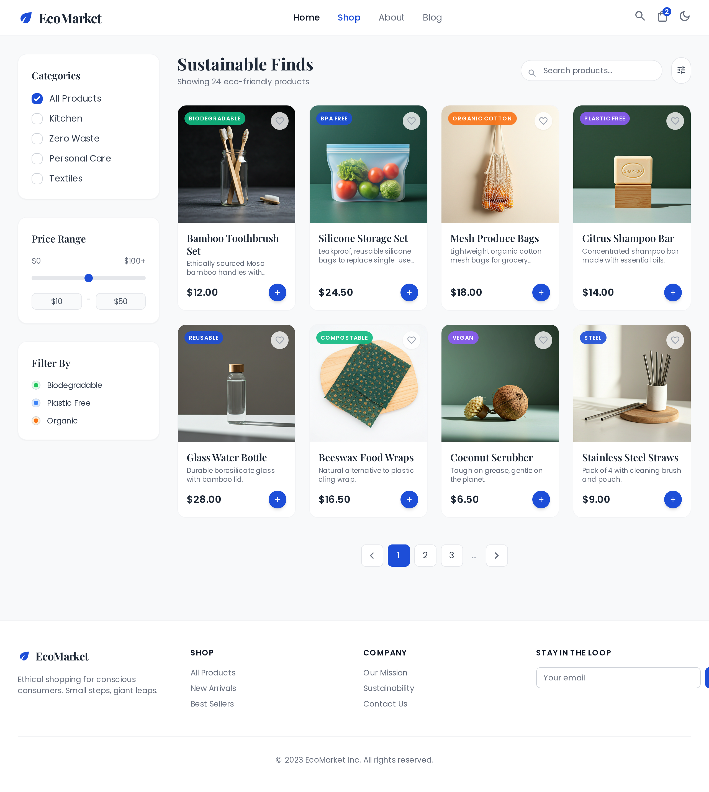
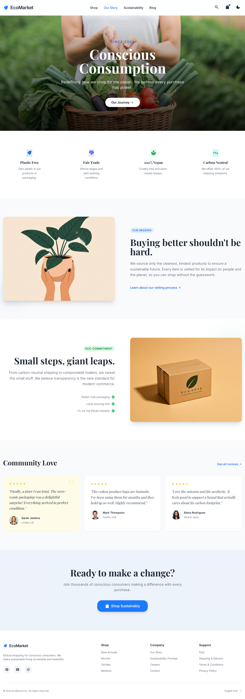
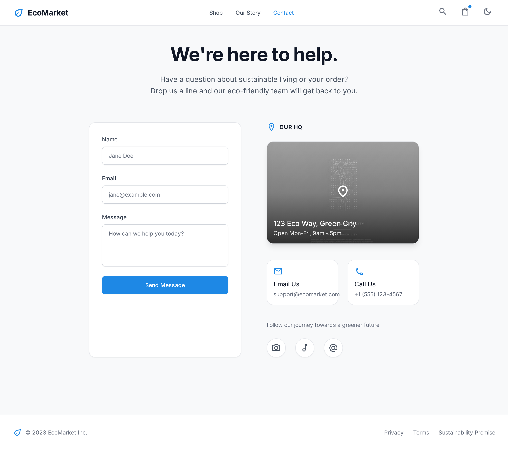
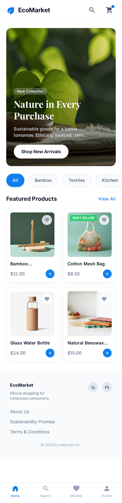
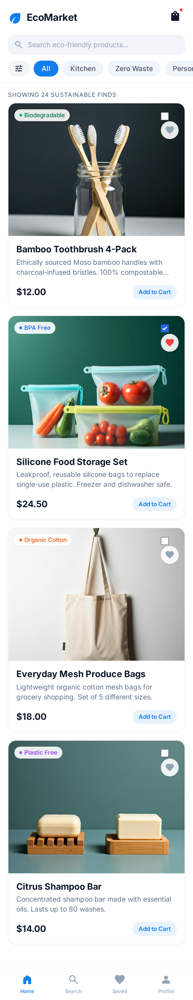
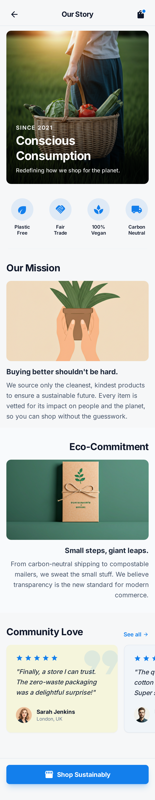
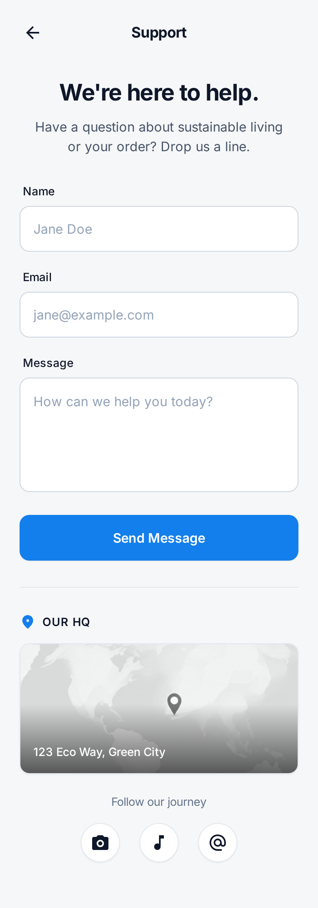

# 🌱 EcoMarket — Tienda en Línea de Productos Ecológicos y Sostenibles


-1572b6?style=for-the-badge&logo=css3&logoColor=white)


---

## 📖 1. Descripción del Proyecto

**EcoMarket** es una plataforma web de comercio electrónico dedicada exclusivamente a la exhibición de **productos ecológicos, reutilizables, biodegradables y de comercio justo**. Su propósito es ofrecer una interfaz limpia, fresca y accesible donde los usuarios puedan explorar alternativas sostenibles para el hogar y el cuidado personal, promoviendo un estilo de vida *Zero Waste* (Cero Residuos).

Este proyecto fue desarrollado cumpliendo el reto técnico de **Cero JavaScript**, resolviendo el 100% de la interactividad, las validaciones de formularios, los estados de favoritos y las animaciones exclusivamente mediante **HTML5 Semántico** y **CSS3 Puro**.

---

## 🎯 2. Características y Vistas Principales

El sitio está estructurado en **4 vistas principales** interconectadas y adaptables a cualquier dispositivo:

### 🏠 A. Página de Inicio (`index.html`)
- **Encabezado (`<header>`)**: Logotipo `🌱 EcoMarket`, barra de navegación principal (`Inicio`, `Productos`, `Nosotros`, `Contacto`) y accesos rápidos a Búsqueda y Carrito.
- **Banner Principal (Hero)**: Imagen panorámica ecológica con el mensaje *"Compra responsable, vive sostenible"* y botón de llamado a la acción (`Explorar productos`).
- **Barra de Categorías**: Botones rápidos con desplazamiento horizontal fluido en pantallas móviles (`overflow-x: auto`).
- **Productos Destacados**: Cuadrícula de **6 tarjetas** con fotografía real, etiqueta superior, descripción breve, precio y botón `"Ver más"` con elevación suave al pasar el cursor (`:hover`).

### 🛍️ B. Catálogo de Productos (`views/productos.html`)
- **Barra Superior**: Encabezado descriptivo y buscador estilizado (`<input type="search">`) con indicador de foco accesible (`:focus-visible`).
- **Matriz de 20 Productos Ecológicos**: Organizados con **CSS Grid** bajo enfoque **Mobile First**:
  - 📱 **Móvil (`base`)**: `1 columna` (`1fr`)
  -  tablet **Tablet (`>= 600px`)**: `2 columnas` (`repeat(2, 1fr)`)
  - 🖥️ **Escritorio (`>= 1024px`)**: `4 columnas` (`repeat(4, 1fr)`)
- **Tarjetas Interactivas (`<article class="tarjeta">`)**:
  - Fotografía real optimizada, título, descripción con etiquetas semánticas (`<strong>`, `<em>`, `<abbr title="...">`) y precio.
  - **Insignias de Estado**: Etiquetas superpuestas (`En Stock`, `¡Oferta!` con animación `@keyframes` que se pausa en `:hover`, y `Agotado`).
  - **Estado Agotado (`.tarjeta--agotado`)**: Tarjetas con opacidad reducida (`opacity: 0.6`), sin elevación en hover gracias a `:not(.tarjeta--agotado):hover` y botón deshabilitado (`[disabled]`).
  - **Botón de Favoritos (❤) 100% CSS**: Implementado con un `<input type="checkbox">` oculto y su `<label>` adyacente (`+`), cambiando de gris a rojo al hacer clic mediante la pseudoclase `:checked`.
- **Paginación Visual**: Controles inferiores (`Anterior`, `1`, `2`, `3`, `Siguiente`).

### 🌿 C. Sobre Nosotros (`views/sobre-nosotros.html`)
- **Nuestra Historia**: Sección maquetada con **Flexbox** que combina texto sobre el origen de EcoMarket y una fotografía representativa (`historia ecologica.jpg`).
- **Principios Ecológicos**: Bloques de valores fundamentales (`🌿 Sin Plástico`, `🐰 100% Vegano`, `🤝 Comercio Justo`).
- **Carrusel de Testimonios CSS**: Contenedor deslizable horizontalmente (`overflow-x: auto`) con 3 reseñas de clientes, calificación en estrellas y avatares circulares (`border-radius: 50%`).

### ✉️ D. Página de Contacto (`views/contacto.html`)
- **Formulario con Validación Visual CSS**: Campos obligatorios para Nombre, Correo Electrónico y Mensaje que cambian automáticamente el color de su borde sin usar scripts:
  - 🔴 **Borde Rojo (`:required:invalid`)**: Cuando el campo está vacío o el formato del correo es incorrecto.
  - 🟢 **Borde Verde (`:required:valid`)**: Cuando el usuario ingresa datos válidos.
- **Ubicación y Redes Sociales**: Imagen estática del mapa de la sede (`mapa.jpg`), dirección, horarios e iconos de redes sociales con animación de crecimiento (`transform: scale(1.1)`) en `:hover`.

---

## 🛠️ 3. Tecnologías y Arquitectura Aplicada

| Tecnología / Metodología | Implementación en el Proyecto |
| :--- | :--- |
| **HTML5 Semántico** | Uso estricto de `<header>`, `<nav>`, `<main>`, `<section>`, `<article>`, `<form>` y `<footer>`, más etiquetas de texto `<strong>`, `<em>`, `<s>` y `<abbr>`. |
| **CSS3 Custom Properties** | Variables globales en `:root` (`--color-primary: #2ecc71`, `--color-secondary: #27ae60`, `--color-bg: #f5f5dc`, `--font-base: sans-serif`). |
| **CSS Grid & Flexbox** | Maquetación bidimensional para catálogos de productos y alineación flexible en menús, encabezados, historia y carruseles. |
| **Selectores y Pseudoclases** | Combinadores (`>`, `+`), selectores de atributo (`[disabled]`, `input[type="search"]`) y pseudoclases (`:hover`, `:not()`, `:checked`, `:valid`, `:invalid`, `:focus-visible`). |
| **Metodología BEM** | Nomenclatura modular (`bloque`, `bloque__elemento`, `bloque--modificador`) para mantener un CSS escalable y libre de `!important`. |
| **Git & GitFlow** | Trabajo estructurado por ramas (`feature/home`, `feature/catalogo`, `feature/sobre-nosotros`, `feature/contacto-form`, `feature/documentacion` y `master`). |

---

## 📂 4. Estructura de Archivos del Proyecto

```text
EcoMarket/
├── css/
│   ├── main.css            # Variables (:root), reset universal y tipografía base
│   ├── layout.css          # Header, Footer, contenedores, CSS Grid y Media Queries
│   ├── components.css      # Botones, tarjetas, favoritos (:checked) y validaciones (:valid/:invalid)
│   └── animations.css      # Keyframes (@keyframes pulsoOferta) y control de estados
├── img/
│   ├── products/           # 20 fotografías reales de los productos ecológicos
│   ├── hero/               # Imagen de respaldo para cabeceras
│   ├── icons/              # Iconografía del proyecto
│   ├── fondo.webp          # Ilustración ecológica del Banner Hero
│   ├── historia ecologica.jpg # Imagen principal de la sección Sobre Nosotros
│   ├── mapa.jpg            # Mapa estático de ubicación en Contacto
│   ├── cliente1.png        # Avatar del testimonio 1
│   ├── cliente2.png        # Avatar del testimonio 2
│   └── cliente3.png        # Avatar del testimonio 3
├── views/
│   ├── productos.html      # Vista del Catálogo (20 productos + buscador + favoritos CSS)
│   ├── sobre-nosotros.html # Vista de Historia, principios ecológicos y testimonios
│   └── contacto.html       # Vista de Formulario validado por CSS y mapa de sede
├── index.html              # Vista Principal (Home: Hero + categorías + 6 destacados)
└── README.md               # Documentación general del proyecto
```

---

## 🚀 5. Instrucciones de Visualización en Local

1. **Clonar el repositorio** en tu máquina local:
   ```bash
   git clone https://github.com/jesusalbertoperezuribe/Ecologia.git
   ```
2. **Abrir la carpeta del proyecto**:
   ```bash
   cd Ecologia
   ```
3. **Ejecutar el proyecto**:
   - **Opción 1 (Directa)**: Haz doble clic sobre el archivo `index.html` para abrirlo en cualquier navegador web moderno (Chrome, Edge, Firefox, Safari).
   - **Opción 2 (Con VS Code)**: Abre la carpeta en **Visual Studio Code**, haz clic derecho sobre `index.html` y selecciona **"Open with Live Server"**.

---

## 📸 6. Capturas de Pantalla (Vistas de Referencia)

### 🖥️ Vistas en Escritorio (Desktop)

| Página de Inicio (Home) | Catálogo de Productos |
| :---: | :---: |
|  |  |

| Sobre Nosotros (Brand Story) | Contacto y Soporte |
| :---: | :---: |
|  |  |

---

### 📱 Vistas en Dispositivos Móviles (Mobile First)

| Inicio Móvil | Catálogo Móvil | Sobre Nosotros Móvil | Contacto Móvil |
| :---: | :---: | :---: | :---: |
|  |  |  |  |

---

## 👨‍💻 Autor
Desarrollado para el proyecto **EcoMarket** — Maquetación Web con **HTML5 Semántico y CSS3 Puro**.

| Sobre Nosotros (Brand Story) | Contacto y Soporte |
| :---: | :---: |
|  |  |

---

### 📱 Vistas en Dispositivos Móviles (Mobile First)

| Inicio Móvil | Catálogo Móvil | Sobre Nosotros Móvil | Contacto Móvil |
| :---: | :---: | :---: | :---: |
|  |  |  |  |

---

## 👨‍💻 Autor
Desarrollado para el proyecto **EcoMarket** — Maquetación Web con **HTML5 Semántico y CSS3 Puro**.

